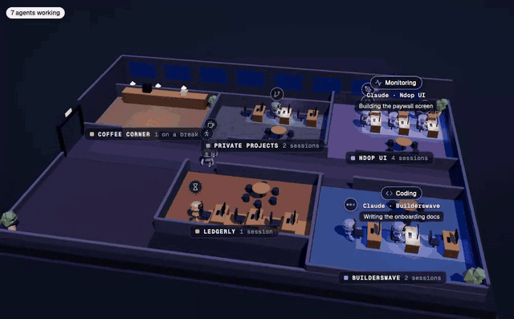

# Hivefloor

A self-hostable 3D office that shows your Claude Code sessions live. Each session is an animated robot at a desk, in a room for its project, doing the kind of work it is doing right now. Subagents take seats at the team table, idle robots go for coffee, and finished sessions walk out. It runs on Cloudflare's free plan.



**[See the live office](https://hivefloor.valerymelou.com/office/)** · [Docs](https://hivefloor.valerymelou.com/docs)

## Set up your office

You need Node 22 or later, Git, a free Cloudflare account and Claude Code. It takes about 10 minutes.

```bash
git clone https://github.com/valerymelou/hivefloor.git
cd hivefloor
corepack enable
pnpm install
cp office.config.example.json office.config.json   # then set your owner and timezone
pnpm nx build web
pnpm --filter @hivefloor/relay exec wrangler login
npm install -g hivefloor
hivefloor deploy                                   # say yes to creating the secret
hivefloor init --url https://hivefloor.your-name.workers.dev
hivefloor doctor
```

Start a new Claude Code session and open your office's URL. The [self-hosting guide](docs/self-hosting.md) explains each step.

## Privacy promise

Your machine decides what the office sees. Private projects send three facts per event: which robot, what kind of work, and when. File paths, commands, prompts, file contents and private project names never leave your machine. Every folder is private until you make it public. See [privacy](docs/privacy.md).

## Try it without setting anything up

```bash
pnpm install
pnpm nx serve web
```

Open http://localhost:4200/#demo to see the office with simulated sessions.

## Repository

| Path              | What                                                                  |
| ----------------- | --------------------------------------------------------------------- |
| `packages/schema` | The contract: schemas, types, constants and the room layout function. |
| `packages/cli`    | The `hivefloor` CLI and the Claude Code hook (published to npm).      |
| `apps/relay`      | Cloudflare Worker and Office Durable Object.                          |
| `apps/web`        | The Angular office app: 3D scene, overlay and list view.              |
| `apps/site`       | Landing page and docs for hivefloor.valerymelou.com.                  |
| `docs/`           | Guides, the product requirements and architecture decision records.   |

## Contribute

See [CONTRIBUTING.md](CONTRIBUTING.md) for the workflow and conventions.

## Licence

[MIT](LICENSE). See [third-party notices](THIRD_PARTY_NOTICES.md). Hivefloor is an independent project and is not affiliated with or endorsed by Anthropic. "Claude" is used only to describe what a robot represents.
