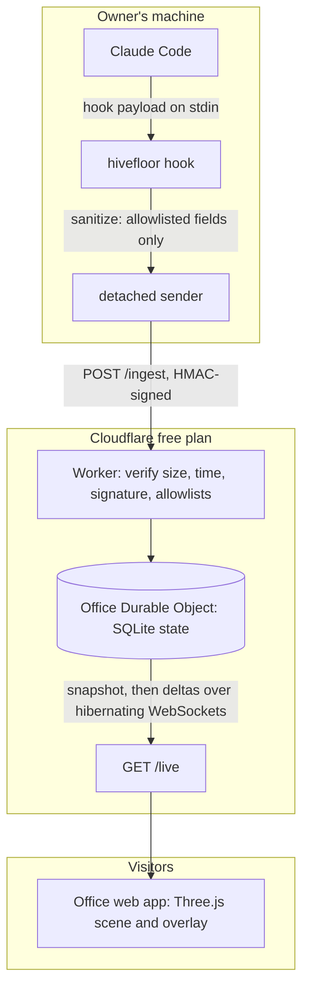

# Architecture

Hivefloor has three parts: a CLI on the owner's machine, a relay on Cloudflare, and the office web app in each visitor's browser. They share one contract, `packages/schema`.

1. Claude Code runs `hivefloor hook` for each hook event, asynchronously, so it never waits.
2. The hook builds a new event from scratch using only allowlisted fields, then hands it to a detached process that signs and sends it.
3. The Worker re-validates everything (the second gate) and forwards it to one Durable Object.
4. The Durable Object updates rooms, robots, desks and today's counts using the shared `layout` function, then broadcasts the change.
5. Each browser applies the change to its store and the 3D scene follows.

## Projects in this repository

| Project           | Nx tag        | May import               |
| ----------------- | ------------- | ------------------------ |
| `packages/schema` | `type:shared` | nothing in the workspace |
| `packages/cli`    | `scope:cli`   | `packages/schema`        |
| `apps/relay`      | `scope:relay` | `packages/schema`        |
| `apps/web`        | `scope:web`   | `packages/schema`        |
| `apps/site`       | `scope:site`  | `packages/schema`        |
| `apps/web-e2e`    | `type:e2e`    | `packages/schema`        |

The `@nx/enforce-module-boundaries` ESLint rule fails the build if a project imports across these lines. Run `pnpm nx graph` to see the current graph.

Detailed sections on the relay, the office state and the scene are added in M4 to M6. Background: [the PRD](PRD.md#architecture) and the [decision records](adr/README.md).
