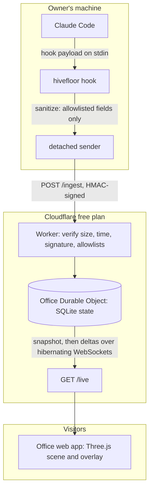
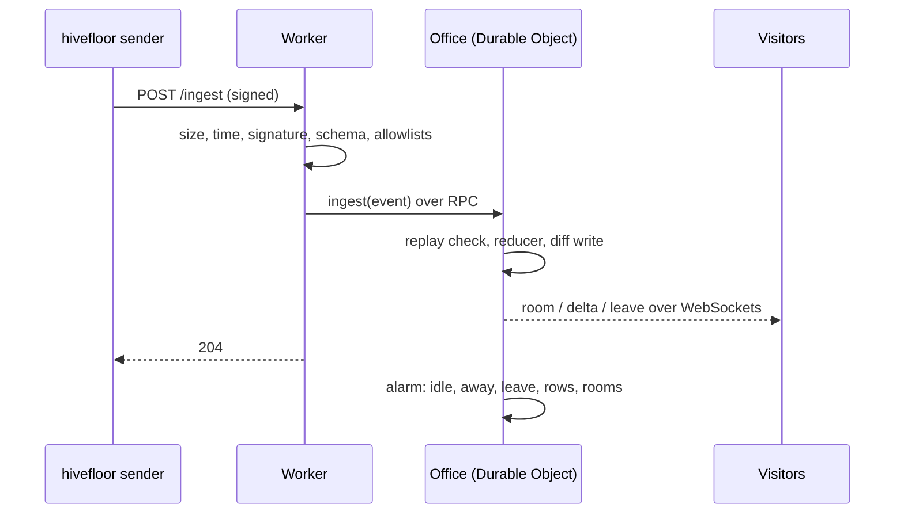

# Architecture

Hivefloor has three parts: a CLI on the owner's machine, a relay on Cloudflare, and the office web app in each visitor's browser. They share one contract, `packages/schema`.

1. Claude Code runs `hivefloor hook` for each hook event, asynchronously, so it never waits.
2. The hook builds a new event from scratch using only allowlisted fields, then hands it to a detached process that signs and sends it.
3. The Worker re-validates everything (the second gate) and forwards it to one Durable Object.
4. The Durable Object updates rooms, robots, desks and today's counts using the shared `layout` function, then broadcasts the change.
5. Each browser applies the change to its store and the 3D scene follows.

## Projects in this repository

| Project           | Nx tag        | May import               |
| ----------------- | ------------- | ------------------------ |
| `packages/schema` | `type:shared` | nothing in the workspace |
| `packages/cli`    | `scope:cli`   | `packages/schema`        |
| `apps/relay`      | `scope:relay` | `packages/schema`        |
| `apps/web`        | `scope:web`   | `packages/schema`        |
| `apps/site`       | `scope:site`  | `packages/schema`        |
| `apps/web-e2e`    | `type:e2e`    | `packages/schema`        |

The `@nx/enforce-module-boundaries` ESLint rule fails the build if a project imports across these lines. Run `pnpm nx graph` to see the current graph.

## The relay

The Worker verifies every `POST /ingest` (size, time, signature, schema, allowlists) and forwards the event over RPC to one `Office` Durable Object, which also checks replays. The object applies the event with a pure reducer, writes only the SQLite rows that changed, broadcasts the resulting messages to every open WebSocket, and sets an alarm for the next presence change. With nobody in the office there is no alarm and the object hibernates. See [ADR 0013](adr/0013-relay-office-state.md).

## The web app

The relay serves the built Angular app. One `OfficeStore` holds the page's state as signals; a pure reducer applies each message (`snapshot`, `room`, `delta`, `leave`, `roomClosed`, `today`, `status`) and feeds the activity list. The store reads from a source: the relay's WebSocket (with reconnection, the "Office closed" state and busy polling) or, with `#demo`, a simulator that sends the same messages. The overlay components only read the store. See [ADR 0014](adr/0014-web-foundation.md).

The 3D office lives in `scene/`. Its pure modules turn the shared `layout` result into geometry (`plan`), walks (`navigation`), what each robot does and says (`behaviour`), and camera framing and picking (`camera`). `scene/render/` is the only code that touches Three.js. It loads on demand, so the overlay appears first, and it receives the store's view on every change. See [ADR 0015](adr/0015-3d-office.md).

Background: [the PRD](PRD.md#architecture) and the [decision records](adr/README.md).
